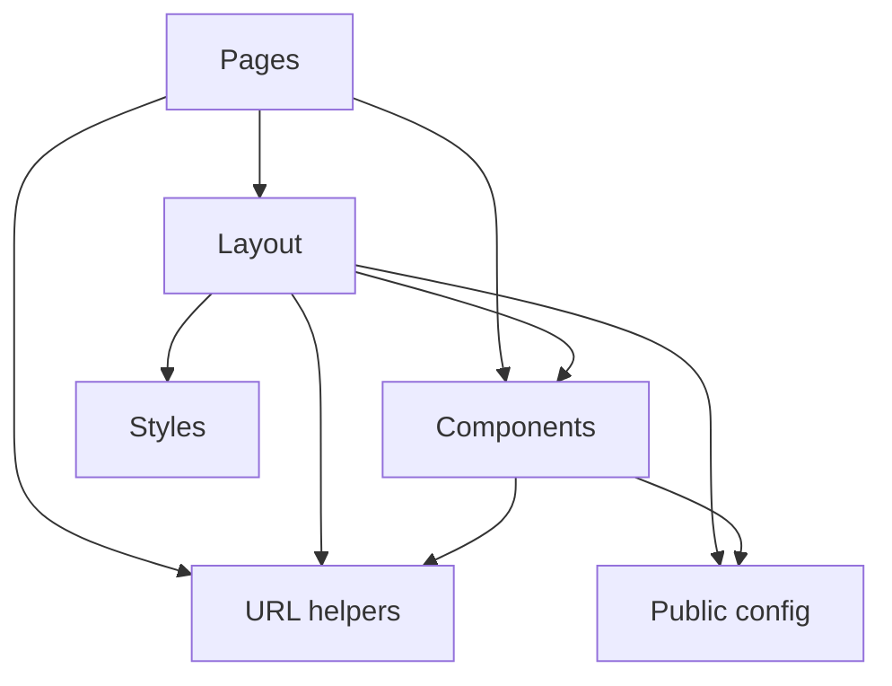

# KnowzCode — Project architecture

Map for C-0001. Accepted decisions live in docs/adr/ADR-0001-static-astro-base.md. Current work lives in .ai/state.json.

## Modules and NodeIDs

| NodeID | Contract | Responsibilities |
| --- | --- | --- |
| Hosting | .github/AGENTS.md; src/lib/AGENTS.md | Static build/deploy and URL base handling |
| Interface | docs/modules/pages.md; src/layouts/AGENTS.md; src/components/AGENTS.md; src/styles/AGENTS.md; src/config/AGENTS.md | Routes, document shell, shared design, public content settings |
| AgentContext | .ai/AGENTS.md | On-demand workflows, current state, policy, handoff |
| Verification | tests/AGENTS.md | Type, behavior, browser, accessibility checks |

## Dependency map

No reverse imports or circular dependencies. The workflow builds HTML/CSS before hosting. No server adapter, persistent store, application AI provider, or agent orchestration runs on the website. KnowzCode is development context only.

## Invariants

Static output; local assets; public config without credentials; one base prefix for internal URLs; semantic keyboard-accessible UI; shared tokens; small context loaded on demand. New modules, public-interface redesigns, services, schemas, or infrastructure changes require an ADR and explicit requested scope.

## C-0003 UI authority

ADR-0002 places current reusable visual requirements in docs/ui/design.md with 12 on-demand component contracts and a structural manifest. Root/local agent entry points require explicit lookup. Styles adds portfolio.css through global.css while retaining two layout imports. No application module or runtime dependency direction changes. tools/check-ui-contract.mjs is development verification only. Historical C-0002 values do not override the current UI authority.

## C-0004 portfolio implementation

Homepage composes nine focused presentational components and shared shell. SelectedWork uses a pure low-level filter selector with minimal client behavior; all content remains HTML without script. Ten original WebP images live in public/images. Static Sites publication uses .openai/hosting.json; the existing GitHub Pages workflow remains available. No adapter, application service, runtime model, new dependency, reverse import or new architectural boundary is added.
